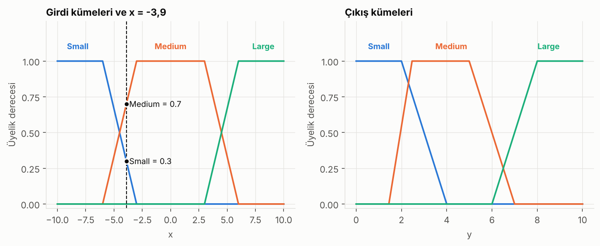
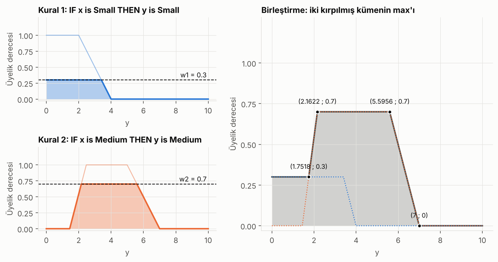
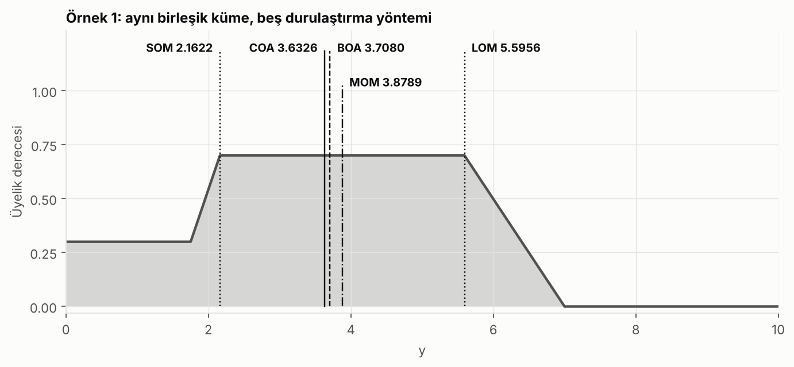
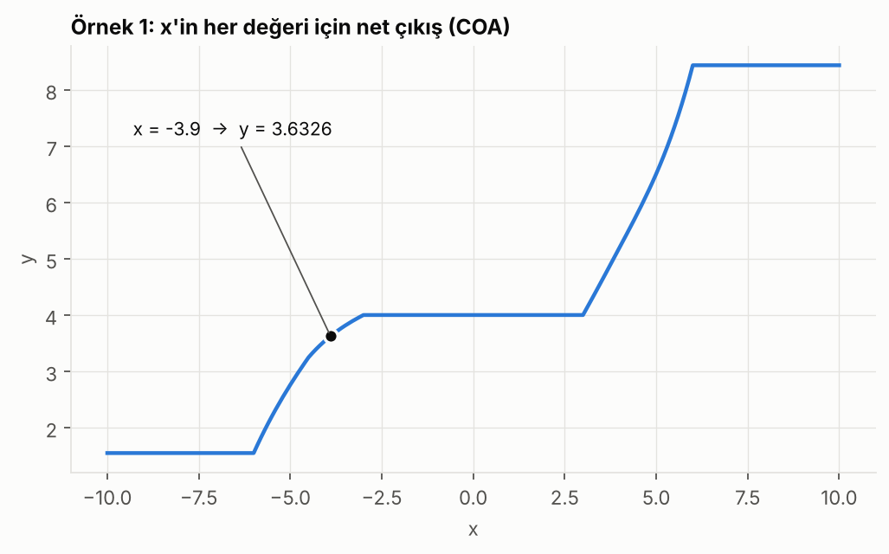
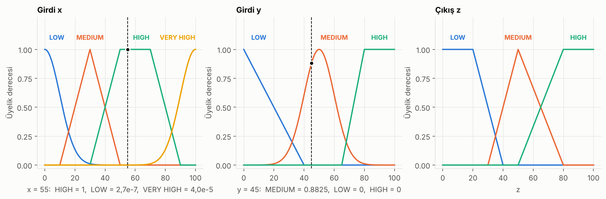
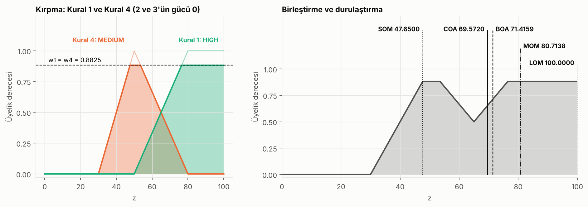

# Fuzzy Logic (Mamdani): Step-by-Step Worked Examples

[Türkçe](README.md) | English

A project that walks through a Mamdani fuzzy inference system from start to finish: membership functions, rule evaluation, clipping, aggregation and five defuzzification methods. Every step of two example problems is computed by hand, and Python code reproduces the same calculation along with a general Mamdani engine.

| Example | System | Input |
|---|---|---|
| 1 | Single-input, 3-rule Mamdani model (trapezoidal sets) | x = -3.9 |
| 2 | Two-input controller, 4 rules (Gaussian, triangular and trapezoidal sets) | x = 55, y = 45 |

> Note: identifiers, comments and script output are in Turkish (e.g. `yamuk` = trapezoid, `ucgen` = triangle, `kes` = clip, `birlestir` = aggregate, `durulastir` = defuzzify, `merkez_ortalamasi` = centroid, `alan_ortayi` = bisector).

## Files

| File | Contents |
|---|---|
| [`bulanik.py`](bulanik.py) | `yamuk`, `ucgen`, `gauss`; `ve` (min), `veya` (max); `kes`, `birlestir`; 5 defuzzification methods; the `mamdani` engine |
| [`ornekler.py`](ornekler.py) | Membership functions and rules of both examples (single place) |
| [`tek_girdili_el_hesabi.py`](tek_girdili_el_hesabi.py) | Prints the hand calculation of Example 1 step by step |
| [`kontrolcu_el_hesabi.py`](kontrolcu_el_hesabi.py) | Prints the hand calculation of Example 2 step by step |
| [`gorseller_uret.py`](gorseller_uret.py) | Generates the PNGs under `gorseller/` |
| [`test_el_hesaplari.py`](test_el_hesaplari.py) | Checks that the numbers in this README match the code |

## Run it

```bash
pip install -r requirements.txt

python tek_girdili_el_hesabi.py
python kontrolcu_el_hesabi.py

python gorseller_uret.py        # regenerate the figures
python test_el_hesaplari.py     # or: pytest
```

Every number in this README is the output of these scripts. If `scikit-fuzzy` is installed, the tests also cross-check the defuzzification results against it (optional).

---

## 1. The idea: classical logic vs. fuzzy logic

In classical (Boolean) logic a statement is 0 or 1: is the room "hot"? Yes or no. In real life we say "a bit hot" at 25 °C and "very hot" at 35 °C. Fuzzy logic models this as follows: **an element belongs to a set with a membership degree between 0 and 1.**

For example, at 28 °C the "warm" membership could be 0.3 and the "hot" membership 0.7. Both hold at the same time.

The membership function for an element u:

```
μA(u) : U -> [0, 1]        U is the universe, A is a fuzzy subset of U
μA(u) = 1  -> u fully belongs to A
μA(u) = 0  -> u does not belong to A
```

Fuzzy logic lets us process linguistic and vague knowledge with IF-THEN rules (washing machines, air conditioners, ABS, metro and elevator control).

## 2. The Mamdani model: 5 steps

```
Input -> Fuzzification -> [fuzzy input set] -> Inference unit <-> Rule base
Inference unit -> [fuzzy output set] -> Defuzzification -> Output
```

Rule form: **IF x is A THEN y is B.**

| Step | What happens | In code |
|---|---|---|
| 1. Fuzzification | Crisp inputs are converted to membership degrees via membership functions | `yamuk`, `ucgen`, `gauss` |
| 2. Rule evaluation | The operators in the rule's condition are applied: `min` for AND, `max` for OR | `ve`, `veya` |
| 3. Implication | The firing strength clips the rule's output set: `min(w, μ(y))` | `kes` |
| 4. Aggregation | The clipped output sets of all rules are merged into one fuzzy set with `max` | `birlestir` |
| 5. Defuzzification | A single crisp value is produced from the aggregated set | `durulastir` |

## 3. Membership functions

**Trapezoid** `yamuk(x; a, b, c, d)`:

```
μ(x) = max( min( (x - a)/(b - a), 1, (d - x)/(d - c) ), 0 )
```

If `a = b` the left edge is vertical, if `c = d` the right edge is (a shoulder). The **triangle** `ucgen(x; a, b, c)` is a trapezoid with its peak at `b` (`b = c`).

**Gaussian** `gauss(x; σ, μ)`:

```
μ(x) = exp( -1/2 * ((x - μ) / σ)^2 )
```

The parameter order is `(σ, μ)`: in `gaussian(x; 10, 0)`, σ = 10 and μ = 0. The support of a Gaussian is infinite: the value shrinks quickly away from the center (μ) but never becomes exactly 0. The tails extend to infinity on both sides, approaching the axis without ever touching it.

---

## 4. Example 1: single-input Mamdani model (3 rules)

Input universe `x ∈ [-10, 10]`, output universe `y ∈ [0, 10]`. Rules:

```
Rule 1: IF x is Small  THEN y is Small
Rule 2: IF x is Medium THEN y is Medium
Rule 3: IF x is Large  THEN y is Large
```

Question: what is y for x = -3.9?



### Step 1: Fuzzification

```
Small  = yamuk(-10, -10, -6, -3):  (-3 - x)/(-3 - (-6)) = (-3 - (-3.9))/3 = 0.3000
Medium = yamuk(-6, -3, 3, 6):      (x - (-6))/(-3 - (-6)) = (-3.9 + 6)/3  = 0.7000
Large  = yamuk(3, 6, 10, 10):      0 because x < 3
```

### Step 2: Rule evaluation

Each rule has a single condition, so the firing strength is the membership degree itself:

```
Rule 1  ->  w1 = 0.3
Rule 2  ->  w2 = 0.7
Rule 3  ->  w3 = 0     (does not fire)
```

There is no fuzzy input related to Large, so only the rules for Small and Medium apply.

### Step 3: Implication (clipping)

The Small output set is clipped at 0.3 and the Medium output set at 0.7. Large vanishes completely because `w3 = 0`.

### Step 4: Aggregation

The `max` of the two clipped sets is taken. The edges of Medium:

```
left edge  : mu(y) =  0.9747*y - 1.4074     (reaches 0.3 at y = 1.7518, 0.7 at y = 2.1622)
right edge : mu(y) = -0.4984*y + 3.4890     (leaves 0.7 at y = 5.5956, reaches 0 at y = 7)
```

The aggregated set has four pieces:

| Piece | Interval | μ(y) |
|---|---|---|
| I | [0 ; 1.7518] | 0.3 (clipped Small) |
| II | [1.7518 ; 2.1622] | 0.9747·y − 1.4074 |
| III | [2.1622 ; 5.5956] | 0.7 |
| IV | [5.5956 ; 7] | −0.4984·y + 3.4890 |



### Step 5: Defuzzification

For each piece, the area `∫ μ dy` and the moment `∫ y·μ dy`:

| Piece | Area | Moment |
|---|---|---|
| I | 0.5255 | 0.4603 |
| II | 0.2052 | 0.4072 |
| III | 2.4034 | 9.3224 |
| IV | 0.4915 | 2.9806 |
| **Total** | **3.6257** | **13.1705** |

- **COA (Centroid):** 13.1705 / 3.6257 = **3.6326**. We defuzzify by finding the center point of the resulting area.
- **BOA (Bisector):** half of the total area is 1.8128. The first two pieces hold 0.7307, and the half is reached inside piece III: 0.7307 + 0.7·(t − 2.1622) = 1.8128, so t = **3.7080**.
- **SOM, LOM, MOM:** The maximum membership is 0.7 and it is constant on piece III. SOM = **2.1622**, LOM = **5.5956**, MOM = (2.1622 + 5.5956) / 2 = **3.8789**.



The hand calculation and the output of the `bulanik.py` engine (numerical integral) agree:

| Method | By hand | Engine |
|---|---|---|
| COA | 3.6326 | 3.6326 |
| BOA | 3.7080 | 3.7080 |
| MOM | 3.8789 | 3.8789 |
| SOM | 2.1622 | 2.1622 |
| LOM | 5.5956 | 5.5956 |

### Output for every x

Repeating the same calculation for every x gives the overall input-output curve, i.e. the y output we get for all x values:



---

## 5. Example 2: two-input controller (4 rules)

In a controller, input x, input y and output z are partitioned into sets as shown in the figures.

```
Rule 1: IF x is VERY HIGH OR y is MEDIUM THEN z is HIGH
Rule 2: IF x is MEDIUM    OR y is LOW    THEN z is LOW
Rule 3: IF x is MEDIUM    OR y is HIGH   THEN z is MEDIUM
Rule 4: IF x is LOW       OR y is MEDIUM THEN z is MEDIUM
```

Membership functions (`gauss(x; σ, μ)`):

| Variable | Set | Function |
|---|---|---|
| x | LOW | gaussian(x; 10, 0) |
| x | MEDIUM | triangle(x; 10, 30, 50) |
| x | HIGH | trapezoid(x; 30, 50, 70, 90) |
| x | VERY HIGH | gaussian(x; 10, 100) |
| y | LOW | triangle(y; 0, 0, 40) |
| y | MEDIUM | gaussian(y; 10, 50) |
| y | HIGH | trapezoid(y; 65, 80, 100, 100) |
| z | LOW | trapezoid(z; 0, 0, 20, 40) |
| z | MEDIUM | triangle(z; 30, 50, 80) |
| z | HIGH | trapezoid(z; 50, 80, 100, 100) |

Question: what is z when x = 55 and y = 45? Find it with five defuzzification methods.



### Step 1: Fuzzification

We define a membership function for every input and output. For x = 55 three fuzzy sets are cut (LOW, HIGH, VERY HIGH); for y = 45 only MEDIUM is cut.

```
x = 55:
  LOW       exp(-0.5*((55-0)/10)^2)    = 2.700e-07
  MEDIUM    0 because 55 > 50
  HIGH      min((55-30)/20, 1, (90-55)/20) = min(1.25; 1; 1.75) = 1
  VERY HIGH exp(-0.5*((55-100)/10)^2)  = 4.007e-05
y = 45:
  LOW       0 because 45 > 40
  MEDIUM    exp(-0.5*((45-50)/10)^2)   = 0.8825
  HIGH      0 because 45 < 65
```

### Step 2: Rule evaluation (OR → max)

```
Rule 1: max(4.007e-05 ; 0.8825) = 0.8825   -> z HIGH
Rule 2: max(0 ; 0)              = 0        -> z LOW
Rule 3: max(0 ; 0)              = 0        -> z MEDIUM
Rule 4: max(2.700e-07 ; 0.8825) = 0.8825   -> z MEDIUM
```

### Step 3: Implication (clipping)

The HIGH and MEDIUM output sets are clipped at 0.8825. Rules 2 and 3, with strength 0, vanish when clipped.

### Step 4: Aggregation

```
MEDIUM left edge   (z-30)/20 = 0.8825  ->  z = 47.6499
MEDIUM right edge  (80-z)/30 = 0.8825  ->  z = 53.5251
MEDIUM right edge meets HIGH left edge (80-z)/30 = (z-50)/30  ->  z = 65, μ = 0.5
HIGH left edge     (z-50)/30 = 0.8825  ->  z = 76.4749
```

| Piece | Interval | μ(z) |
|---|---|---|
| I | [30 ; 47.6499] | (z − 30)/20 |
| II | [47.6499 ; 53.5251] | 0.8825 |
| III | [53.5251 ; 65] | (80 − z)/30 |
| IV | [65 ; 76.4749] | (z − 50)/30 |
| V | [76.4749 ; 100] | 0.8825 |

### Step 5: Defuzzification

| Piece | Area | Moment |
|---|---|---|
| I | 7.7880 | 325.2788 |
| II | 5.1848 | 262.2865 |
| III | 7.9320 | 465.8742 |
| IV | 7.9320 | 565.2874 |
| V | 20.7608 | 1831.8820 |
| **Total** | **49.5977** | **3450.6088** |

- **i) COA:** 3450.6088 / 49.5977 = **69.5720**
- **ii) BOA:** half of the area is 24.7988. The accumulated area grows from 20.9048 to 28.8368 inside piece IV, so the half is reached there. Solving the quadratic gives z = **71.4159**.
- **iii) SOM, LOM, MOM:** The maximum membership is 0.8825 and it occurs on two separate flat pieces (II and V). SOM = **47.6499**, LOM = **100**.
  MOM is the mean of the maximum points:
  `(50.5875 · 5.8752 + 88.2375 · 23.5251) / (5.8752 + 23.5251) =` **80.7137**

> Because the maxima are not a single piece, MOM is not the midpoint of SOM and LOM: (SOM + LOM) / 2 would be 73.8250. In Example 1 the maximum is a single flat piece, so both formulas agree.



| Method | By hand | Engine |
|---|---|---|
| COA | 69.572 | 69.572 |
| BOA | 71.416 | 71.416 |
| MOM | 80.714 | 80.714 |
| SOM | 47.650 | 47.650 |
| LOM | 100.000 | 100.000 |

(The engine grid step is 1e-4, so SOM and MOM can differ by ±1e-4 in the last digit; the table is given with 3 decimals.)

---

## 6. Defuzzification methods

| Method | What it does | In code |
|---|---|---|
| Centroid (COA) | Takes the centroid of the aggregated set's area. The most common one. | `merkez_ortalamasi` |
| Bisector (BOA) | Takes the y value that splits the area into two equal halves. | `alan_ortayi` |
| MOM (mean of maxima) | Takes the mean of the values where the membership is maximal. | `maksimumlar_ortalamasi` |
| SOM (smallest of maxima) | Takes the smallest of the values where the membership is maximal. | `maksimumlarin_en_kucugu` |
| LOM (largest of maxima) | Takes the largest of the values where the membership is maximal. | `maksimumlarin_en_buyugu` |
| Weighted average | `Σ wᵢ·zᵢ / Σ wᵢ`. Used in the Sugeno type. | `agirlikli_ortalama` |

## 7. Notes and assumptions

- **Input sets of Example 1.** The exact parameters of the sets are not given in the source example, only the figure. Trapezoids were chosen that reproduce the values read from it (Small = 0.3 and Medium = 0.7 at x = -3.9): `Small = yamuk(-10, -10, -6, -3)`, `Medium = yamuk(-6, -3, 3, 6)`, `Large = yamuk(3, 6, 10, 10)`.
- **Output sets of Example 1.** Back-derived from the corner points of the aggregated figure: (1.7518 ; 0.3), (2.1622 ; 0.7), (5.5956 ; 0.7) and (7 ; 0): `Medium = yamuk(1.444, 2.47, 4.9937, 7)`, `Small = yamuk(0, 0, 2, 4)`. Large does not fire for this input, so it does not affect the result.
- **Difference from the source results.** The source example reports COA = 3.6327 and BOA = 3.7087; this code gives 3.6326 and 3.7080. SOM (2.1622), LOM (5.5956) and MOM (3.8789) match exactly. The difference is below 0.001 and most likely comes from rounded coefficients in the source and from the set parameters being read off a figure.
- **Decimals in Example 2.** The source writes 2.69 × 10⁻⁷ for x(LOW); the exact value is 2.6996 × 10⁻⁷, written here as 2.700 × 10⁻⁷ (the truncated value is 2.69). y(MEDIUM) is rounded to 0.9 in the source; the exact value is 0.8825 and the exact value is used.
- **Rounding.** Numbers on screen are rounded to 4 decimals while the computation runs at full precision. If you round by hand as you go, the last digits can differ slightly.
- **Grid.** Defuzzification uses a numerical integral on a 1-million-point grid; `SOM`, `LOM` and `MOM` can deviate by up to the grid step (1e-5 and 1e-4).

## References

- Zadeh, L. A. (1965). *Fuzzy Sets*. Information and Control, 8(3), 338-353.
- Mamdani, E. H. and Assilian, S. (1975). *An experiment in linguistic synthesis with a fuzzy logic controller*. International Journal of Man-Machine Studies, 7(1), 1-13.
