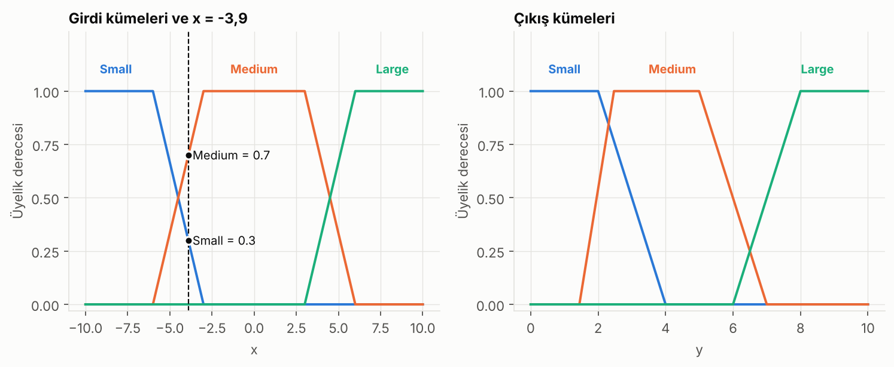
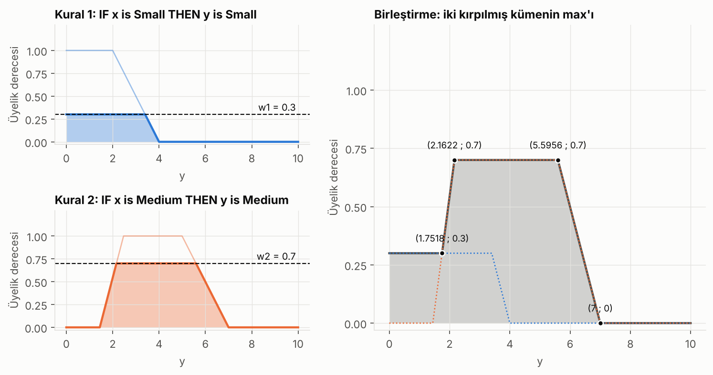
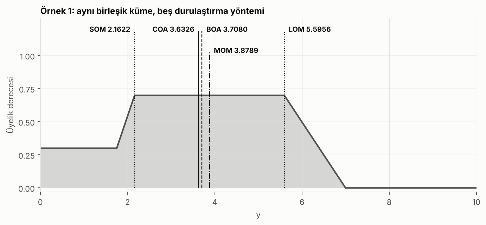
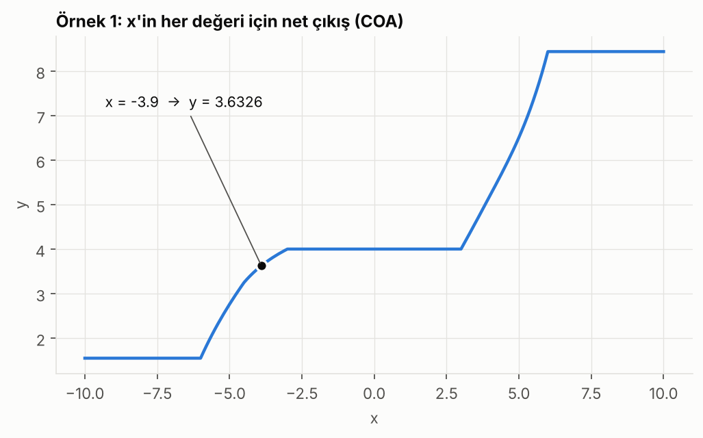
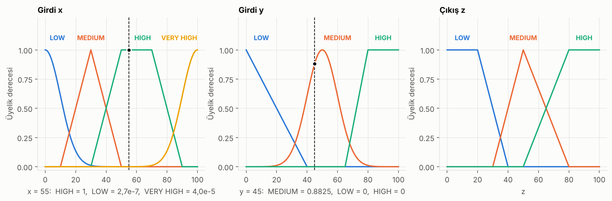
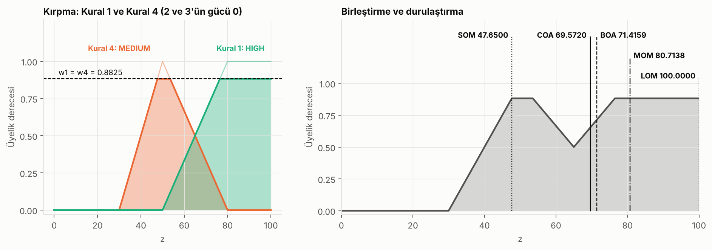
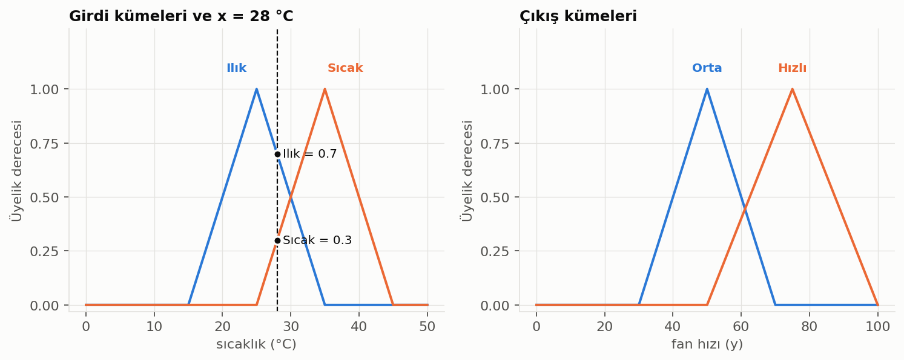
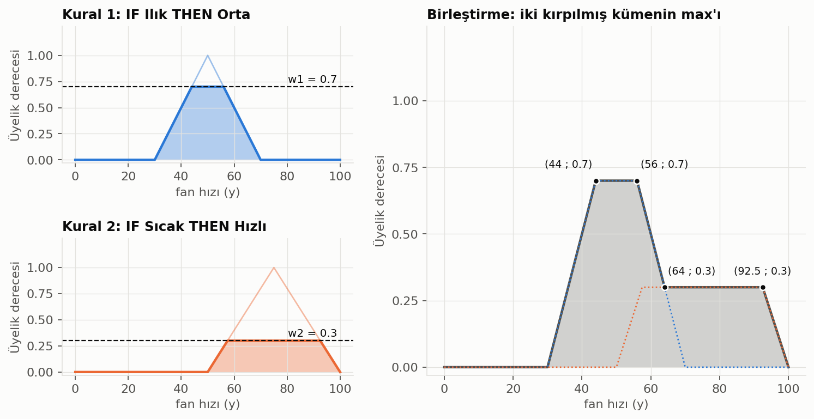
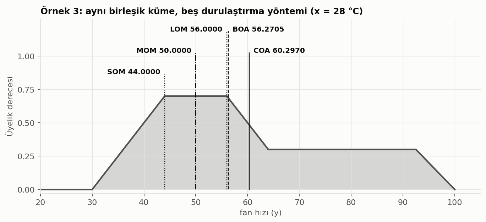
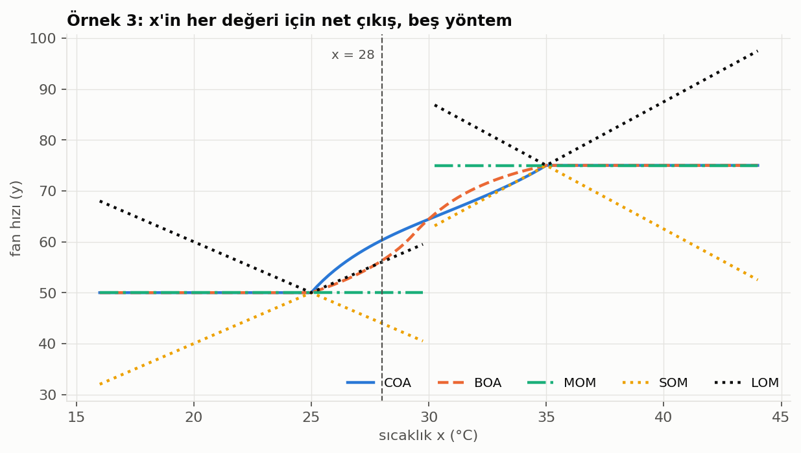

# Bulanık Mantık (Mamdani): Adım Adım El Hesabı

Türkçe | [English](README.en.md)

Mamdani tipi bulanık çıkarım sistemini baştan sona gösteren bir proje: üyelik fonksiyonları, kural değerlendirme, kırpma, birleştirme ve beş durulaştırma yöntemi. Üç örnek problemin her adımı elle hesaplanır, aynı hesabı tekrar eden Python kodu ve genel bir Mamdani motoru vardır.

| Örnek | Sistem | Girdi |
|---|---|---|
| 1 | Tek girdili, 3 kurallı Mamdani modeli (yamuk kümeler) | x = -3,9 |
| 2 | İki girdili kontrolcü, 4 kural (Gauss, üçgen ve yamuk kümeler) | x = 55, y = 45 |
| 3 | Sıcaklık → fan hızı, 2 kural (üçgen kümeler); ayrıca Sugeno karşılaştırması | x = 28 (ve 33) |

## Dosyalar

| Dosya | İçeriği |
|---|---|
| [`bulanik.py`](bulanik.py) | `yamuk`, `ucgen`, `gauss`; `ve` (min), `veya` (max); `kes`, `birlestir`; 5 durulaştırma yöntemi; `mamdani` motoru |
| [`ornekler.py`](ornekler.py) | İki örneğin üyelik fonksiyonları ve kuralları (tek yerde) |
| [`tek_girdili_el_hesabi.py`](tek_girdili_el_hesabi.py) | Örnek 1'in el hesabını adım adım yazdırır |
| [`kontrolcu_el_hesabi.py`](kontrolcu_el_hesabi.py) | Örnek 2'nin el hesabını adım adım yazdırır |
| [`fan_hizi_ornegi.py`](fan_hizi_ornegi.py) | Örnek 3'ün el hesabını adım adım yazdırır |
| [`sugeno_ornegi.py`](sugeno_ornegi.py) | Aynı sistemin Sugeno çözümü ve Mamdani ile karşılaştırma tablosu |
| [`alistirma.py`](alistirma.py) | Rastgele sorular soran alıştırma modu |
| [`gorseller_uret.py`](gorseller_uret.py) | `gorseller/` altındaki PNG'leri üretir |
| [`test_el_hesaplari.py`](test_el_hesaplari.py) | Bu README'deki sayıların kodla tuttuğunu denetler |
| [`test_sugeno.py`](test_sugeno.py), [`test_alistirma.py`](test_alistirma.py) | Sugeno ve alıştırma modu testleri |

## Çalıştırma

```bash
pip install -r requirements.txt

python tek_girdili_el_hesabi.py
python kontrolcu_el_hesabi.py
python fan_hizi_ornegi.py 28     # Örnek 3; başka sıcaklık da verilebilir
python sugeno_ornegi.py
python alistirma.py

python gorseller_uret.py        # görselleri yeniden üret
python test_el_hesaplari.py     # veya: pytest
python test_sugeno.py
python test_alistirma.py
```

Bu README'deki her sayı yukarıdaki scriptlerin çıktısıdır. `scikit-fuzzy` kuruluysa testler durulaştırma sonuçlarını o kütüphaneyle de çapraz kontrol eder (isteğe bağlı).

---

## 1. Temel fikir: klasik mantık ve bulanık mantık

Klasik (Boolean) mantıkta bir önerme 0 ya da 1'dir: oda "sıcak" mı? Ya evet ya hayır. Gerçek hayatta 25 °C için "biraz sıcak", 35 °C için "çok sıcak" deriz. Bulanık mantık bunu şöyle modeller: **bir eleman bir kümeye 0 ile 1 arasında bir üyelik derecesiyle aittir.**

Örneğin 28 °C için "ılık" üyeliği 0,3 ve "sıcak" üyeliği 0,7 olabilir. İkisi aynı anda geçerlidir.

Bir u elemanı için üyelik fonksiyonu:

```
μA(u) : U -> [0, 1]        U genel küme, A, U'nun bulanık alt kümesi
μA(u) = 1  -> u tamamen A'nın elemanı
μA(u) = 0  -> u A'nın elemanı değil
```

Bulanık mantık, dilsel ve belirsiz bilgiyi EĞER-İSE kurallarıyla işlemeyi sağlar (çamaşır makinesi, klima, ABS, metro, asansör denetimi gibi).

## 2. Mamdani modeli: 5 adım

```
Girdi -> Bulanıklaştırma -> [bulanık girdi seti] -> Çıkarım Birimi <-> Kural Tabanı
Çıkarım Birimi -> [bulanık çıkış seti] -> Durulaştırma -> Çıktı
```

Kural biçimi: **EĞER x A ise y B'dir.**

| Adım | Ne yapılır | Kodda |
|---|---|---|
| 1. Bulanıklaştırma | Net girdi, üyelik fonksiyonlarıyla üyelik derecelerine çevrilir | `yamuk`, `ucgen`, `gauss` |
| 2. Kural değerlendirme | Kuralın koşul kısmındaki operatörler uygulanır. VE için `min`, VEYA için `max` | `ve`, `veya` |
| 3. Çıkarım (implication) | Ateşleme gücü, kuralın çıkış kümesini kırpar: `min(w, μ(y))` | `kes` |
| 4. Birleştirme (aggregation) | Tüm kuralların kırpılmış çıkış kümeleri `max` ile tek bulanık kümede birleşir | `birlestir` |
| 5. Durulaştırma | Birleşik kümeden tek bir net değer üretilir | `durulastir` |

Burada ilk iş bulanıklaştırmadır, çünkü net girdileri bulanık dile çevirmeden kurallar uygulanamaz.

## 3. Üyelik fonksiyonları

**Yamuk** `yamuk(x; a, b, c, d)`:

```
μ(x) = max( min( (x - a)/(b - a), 1, (d - x)/(d - c) ), 0 )
```

`a = b` ise sol kenar, `c = d` ise sağ kenar diktir (omuz). **Üçgen** `ucgen(x; a, b, c)`, tepesi `b`'de olan yamuktur (`b = c`).

**Gauss** `gauss(x; σ, μ)`:

```
μ(x) = exp( -1/2 * ((x - μ) / σ)^2 )
```

Parametre sırası `(σ, μ)`'dür: `gaussian(x; 10, 0)` ifadesinde σ = 10, μ = 0. Gauss fonksiyonunun desteği sonsuzdur: merkezden (μ) uzaklaştıkça değer hızla küçülür ama hiçbir zaman tam 0 olmaz. Eğrinin kuyrukları x ekseninde sola ve sağa sonsuza kadar uzanır, eksene sürekli yaklaşır ama ona hiç değmez.

---

## 4. Örnek 1: tek girdili Mamdani modeli (3 kural)

Girdi evreni `x ∈ [-10, 10]`, çıkış evreni `y ∈ [0, 10]`. Kurallar:

```
Kural 1: IF x is Small  THEN y is Small
Kural 2: IF x is Medium THEN y is Medium
Kural 3: IF x is Large  THEN y is Large
```

Soru: x = -3,9 için y ne olur?



### Adım 1: Bulanıklaştırma

```
Small  = yamuk(-10, -10, -6, -3):  (-3 - x)/(-3 - (-6)) = (-3 - (-3.9))/3 = 0.3000
Medium = yamuk(-6, -3, 3, 6):      (x - (-6))/(-3 - (-6)) = (-3.9 + 6)/3  = 0.7000
Large  = yamuk(3, 6, 10, 10):      x < 3 olduğu için 0
```

### Adım 2: Kural değerlendirme

Her kuralın tek koşulu olduğundan ateşleme gücü doğrudan üyelik derecesidir:

```
Kural 1  ->  w1 = 0.3
Kural 2  ->  w2 = 0.7
Kural 3  ->  w3 = 0     (ateşlenmez)
```

Elimizde Large ile ilgili bulanık bir girdi yok. O zaman Small ve Medium'a göre kurallar uygulanıyor.

### Adım 3: Çıkarım (kırpma)

Small çıkış kümesi 0,3 seviyesinden, Medium çıkış kümesi 0,7 seviyesinden kırpılır. Large `w3 = 0` olduğu için tamamen yok olur.

### Adım 4: Birleştirme

Kırpılmış iki kümenin `max`'ı alınır. Medium'un kenarları:

```
sol kenar : mu(y) =  0.9747*y - 1.4074      (0.3'e y = 1.7518'de, 0.7'ye y = 2.1622'de ulaşır)
sağ kenar : mu(y) = -0.4984*y + 3.4890      (0.7'den y = 5.5956'da iner, y = 7'de 0 olur)
```

Birleşik küme dört parçadır:

| Parça | Aralık | μ(y) |
|---|---|---|
| I | [0 ; 1.7518] | 0,3 (Small'ın kırpılmış hâli) |
| II | [1.7518 ; 2.1622] | 0,9747·y − 1,4074 |
| III | [2.1622 ; 5.5956] | 0,7 |
| IV | [5.5956 ; 7] | −0,4984·y + 3,4890 |



### Adım 5: Durulaştırma

Her parça için alan `∫ μ dy` ve moment `∫ y·μ dy`:

| Parça | Alan | Moment |
|---|---|---|
| I | 0,5255 | 0,4603 |
| II | 0,2052 | 0,4072 |
| III | 2,4034 | 9,3224 |
| IV | 0,4915 | 2,9806 |
| **Toplam** | **3,6257** | **13,1705** |

- **COA (Centroid):** 13,1705 / 3,6257 = **3,6326**. Elde ettiğimiz alanın merkez noktasını bularak durulaştırma yapıyoruz.
- **BOA (Bisector):** toplam alanın yarısı 1,8128. İlk iki parçanın alanı 0,7307, III. parçada yarıya ulaşılır: 0,7307 + 0,7·(t − 2,1622) = 1,8128, buradan t = **3,7080**.
- **SOM, LOM, MOM:** Maksimum üyelik 0,7 ve III. parçada sabit. SOM = **2,1622**, LOM = **5,5956**, MOM = (2,1622 + 5,5956) / 2 = **3,8789**.



Elle hesap ile `bulanik.py` motorunun (sayısal integral) çıktısı aynıdır:

| Yöntem | Elle | Motor |
|---|---|---|
| COA | 3.6326 | 3.6326 |
| BOA | 3.7080 | 3.7080 |
| MOM | 3.8789 | 3.8789 |
| SOM | 2.1622 | 2.1622 |
| LOM | 5.5956 | 5.5956 |

### Tüm x değerleri için çıkış

Aynı hesap x'in her değeri için tekrarlanırsa girdi-çıktı eğrisi elde edilir. Yani bütün x'ler için elde ettiğimiz y çıktısı:



---

## 5. Örnek 2: iki girdili kontrolcü (4 kural)

Bir kontrolcüde x girdisi, y girdisi ve z çıktısı şekildeki gibi kümelere ayrılmıştır.

```
Kural 1: IF x is VERY HIGH OR y is MEDIUM THEN z is HIGH
Kural 2: IF x is MEDIUM    OR y is LOW    THEN z is LOW
Kural 3: IF x is MEDIUM    OR y is HIGH   THEN z is MEDIUM
Kural 4: IF x is LOW       OR y is MEDIUM THEN z is MEDIUM
```

Üyelik fonksiyonları (`gauss(x; σ, μ)`):

| Değişken | Küme | Fonksiyon |
|---|---|---|
| x | LOW | gaussian(x; 10, 0) |
| x | MEDIUM | triangle(x; 10, 30, 50) |
| x | HIGH | trapezoid(x; 30, 50, 70, 90) |
| x | VERY HIGH | gaussian(x; 10, 100) |
| y | LOW | triangle(y; 0, 0, 40) |
| y | MEDIUM | gaussian(y; 10, 50) |
| y | HIGH | trapezoid(y; 65, 80, 100, 100) |
| z | LOW | trapezoid(z; 0, 0, 20, 40) |
| z | MEDIUM | triangle(z; 30, 50, 80) |
| z | HIGH | trapezoid(z; 50, 80, 100, 100) |

Soru: x = 55 ve y = 45 iken z nedir? Beş durulaştırma yöntemiyle bulunur.



### Adım 1: Bulanıklaştırma

Her girdi ve çıktı için bir üyelik fonksiyonu tanımlıyoruz. x = 55 için üç bulanık küme kesiyor (LOW, HIGH, VERY HIGH), y = 45 için yalnızca MEDIUM'u kesiyor.

```
x = 55:
  LOW       exp(-0.5*((55-0)/10)^2)    = 2.700e-07
  MEDIUM    55 > 50 olduğu için        = 0
  HIGH      min((55-30)/20, 1, (90-55)/20) = min(1.25; 1; 1.75) = 1
  VERY HIGH exp(-0.5*((55-100)/10)^2)  = 4.007e-05
y = 45:
  LOW       45 > 40 olduğu için        = 0
  MEDIUM    exp(-0.5*((45-50)/10)^2)   = 0.8825
  HIGH      45 < 65 olduğu için        = 0
```

### Adım 2: Kural değerlendirme (VEYA → max)

```
Kural 1: max(4.007e-05 ; 0.8825) = 0.8825   -> z HIGH
Kural 2: max(0 ; 0)              = 0        -> z LOW
Kural 3: max(0 ; 0)              = 0        -> z MEDIUM
Kural 4: max(2.700e-07 ; 0.8825) = 0.8825   -> z MEDIUM
```

### Adım 3: Çıkarım (kırpma)

HIGH ve MEDIUM çıkış kümeleri 0,8825 seviyesinden kırpılır. Gücü 0 olan Kural 2 ve Kural 3 kırpılınca yok olur.

### Adım 4: Birleştirme

```
MEDIUM sol kenar  (z-30)/20 = 0.8825  ->  z = 47.6499
MEDIUM sağ kenar  (80-z)/30 = 0.8825  ->  z = 53.5251
MEDIUM sağ ve HIGH sol kenarı kesişir (80-z)/30 = (z-50)/30  ->  z = 65, μ = 0.5
HIGH sol kenar    (z-50)/30 = 0.8825  ->  z = 76.4749
```

| Parça | Aralık | μ(z) |
|---|---|---|
| I | [30 ; 47.6499] | (z − 30)/20 |
| II | [47.6499 ; 53.5251] | 0,8825 |
| III | [53.5251 ; 65] | (80 − z)/30 |
| IV | [65 ; 76.4749] | (z − 50)/30 |
| V | [76.4749 ; 100] | 0,8825 |

### Adım 5: Durulaştırma

| Parça | Alan | Moment |
|---|---|---|
| I | 7,7880 | 325,2788 |
| II | 5,1848 | 262,2865 |
| III | 7,9320 | 465,8742 |
| IV | 7,9320 | 565,2874 |
| V | 20,7608 | 1831,8820 |
| **Toplam** | **49,5977** | **3450,6088** |

- **i) COA:** 3450,6088 / 49,5977 = **69,5720**
- **ii) BOA:** yarı alan 24,7988. Birikim IV. parçada 20,9048'den 28,8368'e çıkar, yarıya burada ulaşılır. İkinci derece denklem çözülünce z = **71,4159**.
- **iii) SOM, LOM, MOM:** Maksimum üyelik 0,8825 ve iki ayrı düz parçada oluşur (II ve V). SOM = **47,6499**, LOM = **100**.
  MOM, maksimum noktalarının ortalamasıdır:
  `(50,5875 · 5,8752 + 88,2375 · 23,5251) / (5,8752 + 23,5251) =` **80,7137**

> Maksimumlar tek parça olmadığı için MOM, SOM ile LOM'un ortası değildir: (SOM + LOM) / 2 = 73,8250 olurdu. Örnek 1'de maksimum tek düz parça olduğu için iki formül aynı sonucu verir.



| Yöntem | Elle | Motor |
|---|---|---|
| COA | 69.572 | 69.572 |
| BOA | 71.416 | 71.416 |
| MOM | 80.714 | 80.714 |
| SOM | 47.650 | 47.650 |
| LOM | 100.000 | 100.000 |

(Motorun ızgara adımı 1e-4 olduğu için SOM ve MOM'da son hanede ±1e-4 fark olabilir; tablo 3 ondalıkla verildi.)

---

## 6. Örnek 3: sıcaklık → fan hızı (2 kural)

En küçük tam örnek: tek girdi, iki kural, üçgen kümeler. Aşağıdaki her adım [`fan_hizi_ornegi.py`](fan_hizi_ornegi.py) çıktısıyla aynıdır (`python fan_hizi_ornegi.py 28`).

Girdi (sıcaklık, °C), üçgen `(başlangıç, tepe, bitiş)`: Ilık = (15, 25, 35), Sıcak = (25, 35, 45).
Çıkış (fan hızı, 0-100): Orta = (30, 50, 70), Hızlı = (50, 75, 100).

1. EĞER sıcaklık **Ilık** İSE hız **Orta**
2. EĞER sıcaklık **Sıcak** İSE hız **Hızlı**



Girdi x = 28 °C.

### Adım 1: Bulanıklaştırma

Önce x'in tepenin solunda mı sağında mı olduğuna bakılır. Solundaysa yükselen, sağındaysa alçalan kenar kullanılır.

- Ilık (15, **25**, 35): 28 > 25, alçalan kenar → (35 − 28) / (35 − 25) = 7/10 = **0,7**
- Sıcak (25, **35**, 45): 28 < 35, yükselen kenar → (28 − 25) / (35 − 25) = 3/10 = **0,3**

Yükselen kenarda payda `tepe − başlangıç`, pay `x − başlangıç`; alçalan kenarda payda `bitiş − tepe`, pay `bitiş − x`. Her iki durumda da pay, x'in kenarın "sıfır ucundan" uzaklığıdır, payda ise kenarın toplam genişliği.

### Adım 2: Kural değerlendirme

Her kuralda tek koşul var, bu yüzden ateşleme gücü üyelik derecesinin kendisidir: w₁ = 0,7 ve w₂ = 0,3. İki koşul olsaydı VE için `min`, VEYA için `max` alınırdı (Örnek 2).

### Adım 3: Çıkarım (kırpma)

Çıkış kümesi ateşleme gücü seviyesinden kesilir. Kesme çizgisinin kenarlara çarptığı noktalar `sol = başlangıç + w·(tepe − başlangıç)` ve `sağ = bitiş − w·(bitiş − tepe)` ile bulunur.

- Orta, w₁ = 0,7: sol = 30 + 0,7·20 = **44**, sağ = 70 − 0,7·20 = **56**. Köşeler: (30, 0) → (44, 0,7) → (56, 0,7) → (70, 0)
- Hızlı, w₂ = 0,3: sol = 50 + 0,3·25 = **57,5**, sağ = 100 − 0,3·25 = **92,5**. Köşeler: (50, 0) → (57,5, 0,3) → (92,5, 0,3) → (100, 0)

### Adım 4: Birleştirme

Her y noktasında iki kırpılmış kümeden büyük olan alınır. Orta'nın alçalan kenarı 0,3 seviyesine `(70 − y) / 20 = 0,3 → y = 64` noktasında iner; o noktadan sonra Hızlı'nın platosu baskın olur.

Birleşik küme köşeleri: `(30, 0) → (44, 0,7) → (56, 0,7) → (64, 0,3) → (92,5, 0,3) → (100, 0)`



### Adım 5: Durulaştırma

Maksimum üyelik 0,7, plato 44 ile 56 arasında.

| Yöntem | Ne yapar | Sonuç |
|---|---|---|
| SOM | maksimumların en küçüğü | 44 |
| MOM | maksimumların ortalaması (44 + 56) / 2 | 50 |
| LOM | maksimumların en büyüğü | 56 |
| BOA | alanı iki eşit parçaya böler | ≈ 56,2705 |
| COA | alanın ağırlık merkezi | ≈ 60,2970 |

Şekil parçalara bölünerek centroid:

| Parça | Alan | Merkez | Alan × merkez |
|---|---|---|---|
| üçgen (30-44) | 4,9 | 39,333 | 192,733 |
| dikdörtgen (44-56) | 8,4 | 50 | 420 |
| dikdörtgen (56-64, yükseklik 0,3) | 2,4 | 60 | 144 |
| üçgen (56-64, yükseklik 0,4) | 1,6 | 58,667 | 93,867 |
| dikdörtgen (64-92,5) | 8,55 | 78,25 | 669,038 |
| üçgen (92,5-100) | 1,125 | 95 | 106,875 |
| **Toplam** | **26,975** | | **1626,513** |

COA = 1626,513 / 26,975 ≈ **60,297**

BOA için toplam alan 26,975, yarısı 13,4875. Soldan alan biriktirilirse y = 56'ya kadar 4,9 + 8,4 = 13,3 olur. Eksik 0,1875 alan, 56'nın hemen sağındaki eğimli parçada tamamlanır: `0,7·t − 0,025·t² = 0,1875` denkleminden t ≈ 0,2705, yani **y ≈ 56,2705**.



**Yorum:** COA, MOM'dan büyük çıktı çünkü sağdaki uzun 0,3'lük basamak ağırlık merkezini sağa çekiyor. SOM, MOM ve LOM yalnızca en tepedeki platoya baktığı için bu basamağı görmez; COA ve BOA ise şeklin tamamını hesaba katar.

### Başka sıcaklıklar

| Girdi | w₁ (Ilık) | w₂ (Sıcak) | SOM | MOM | LOM | BOA | COA |
|---|---|---|---|---|---|---|---|
| x = 28 | 0,7 | 0,3 | 44 | 50 | 56 | 56,2705 | 60,2970 |
| x = 33 | 0,2 | 0,8 | 70 | 75 | 80 | 72,4375 | 70,2242 |

x = 33'te Hızlı daha güçlü ateşlendiği için maksimum plato Hızlı'nın 0,8 seviyesindeki kesiğine (70 ile 80 arası) düşer ve SOM, MOM, LOM bu platodan okunur.

Girdi arttıkça beş yöntemin nasıl hareket ettiği aşağıda. x = 30'da iki kural da 0,5 ile ateşlenir ve maksimum iki ayrı platoya bölünür (40-60 ve 62,5-87,5): SOM = 40, LOM = 87,5, MOM ≈ 63,89 (iki platonun uzunluk ağırlıklı ortalaması). Bu üç yöntem x = 30'un iki yanında sıçrama yapar, grafikte çizgi bu noktada kesildi. COA ve BOA ise süreklidir.



## 7. Sugeno ile karşılaştırma

[`sugeno_ornegi.py`](sugeno_ornegi.py) aynı kuralları sıfırıncı derece Sugeno modeliyle çözer. Çıkış kümesi yerine her kuralın sonucu bir sabittir (Orta için z₁ = 50, Hızlı için z₂ = 75, yani kümelerin tepeleri) ve çıkış ağırlıklı ortalamadır:

`z = (w₁·z₁ + w₂·z₂) / (w₁ + w₂)`

x = 28 için: z = (0,7·50 + 0,3·75) / (0,7 + 0,3) = 57,5 / 1 = **57,5** (Mamdani COA: 60,297). Kırpma, birleştirme ve integral yoktur.

| x | w₁ | w₂ | Sugeno | Mamdani COA | fark |
|---|---|---|---|---|---|
| 20 | 0,5 | 0 | 50 | 50 | 0 |
| 25 | 1 | 0 | 50 | 50 | 0 |
| 28 | 0,7 | 0,3 | 57,5 | 60,297 | −2,797 |
| 30 | 0,5 | 0,5 | 62,5 | 64,423 | −1,923 |
| 33 | 0,2 | 0,8 | 70 | 70,224 | −0,224 |
| 35 | 0 | 1 | 75 | 75 | 0 |
| 40 | 0 | 0,5 | 75 | 75 | 0 |

Sugeno yalnızca tepe noktalarına bakar. Mamdani COA ise kırpılmış kümelerin genişliğini de hesaba katar; Hızlı (50-100) kümesi Orta'dan (30-70) geniş olduğu için iki kural birlikte ateşlendiğinde (25 < x < 35) sonuç Mamdani'de daha büyük çıkar. Tek kural ateşlendiğinde kırpılmış küme kendi tepesi etrafında simetrik olduğundan ikisi aynıdır.

## 8. Alıştırma modu

[`alistirma.py`](alistirma.py) rastgele bir sıcaklık seçer, üyelikleri ve istediğin durulaştırma sonucunu sorar, cevabını kontrol eder ve yanlışta adım adım çözümü gösterir. Sayıları virgül ya da nokta ile yazabilirsin; üyelik cevapları 0,01, durulaştırma cevapları 0,1 toleransla kabul edilir.

```bash
python alistirma.py                   # 3 rastgele soru
python alistirma.py --soru 5 --yontem COA
python alistirma.py --seed 7          # aynı soruları tekrar üret
python alistirma.py --cozum 28        # x = 28 için çözümü göster, soru sorma
```

## 9. Durulaştırma yöntemleri

| Yöntem | Ne yapar? | Kodda |
|---|---|---|
| Centroid (COA, ağırlık merkezi) | Birleşik kümenin alanının ağırlık merkezini alır. En yaygın olanıdır. | `merkez_ortalamasi` |
| Bisector (alan ortayı) | Alanı iki eşit parçaya bölen y değerini alır. | `alan_ortayi` |
| MOM (mean of maxima) | Üyeliğin maksimum olduğu değerlerin ortalamasını alır. | `maksimumlar_ortalamasi` |
| SOM (smallest of maxima) | Maksimum olduğu değerlerin en küçüğünü alır. | `maksimumlarin_en_kucugu` |
| LOM (largest of maxima) | Maksimum olduğu değerlerin en büyüğünü alır. | `maksimumlarin_en_buyugu` |
| Ağırlıklı ortalama | `Σ wᵢ·zᵢ / Σ wᵢ`. Sugeno tipinde kullanılır. | `agirlikli_ortalama` |

## 10. Notlar ve varsayımlar

- **Örnek 1'in girdi kümeleri.** Kümelerin kesin parametreleri kaynak örnekte yazmıyor, yalnızca şekil var. x = -3,9 için okunan değerleri (Small = 0,3 ve Medium = 0,7) veren yamuklar seçildi: `Small = yamuk(-10, -10, -6, -3)`, `Medium = yamuk(-6, -3, 3, 6)`, `Large = yamuk(3, 6, 10, 10)`.
- **Örnek 1'in çıkış kümeleri.** Birleşik şeklin köşe noktalarından (1,7518 ; 0,3), (2,1622 ; 0,7), (5,5956 ; 0,7) ve (7 ; 0) geri çıkarıldı: `Medium = yamuk(1.444, 2.47, 4.9937, 7)`, `Small = yamuk(0, 0, 2, 4)`. Large bu girdide ateşlenmediği için sonucu etkilemez.
- **Kaynaktaki sonuçlarla fark.** Kaynak örnekte COA = 3,6327 ve BOA = 3,7087 verilmiş; bu kod 3,6326 ve 3,7080 üretir. SOM (2,1622), LOM (5,5956) ve MOM (3,8789) birebir aynıdır. Fark binde birin altındadır; büyük olasılıkla kaynaktaki katsayıların yuvarlanmasından ve kümelerin kesin parametrelerinin şekilden okunmasından gelir.
- **Örnek 2'de ondalıklar.** Kaynakta x(LOW) için 2,69 × 10⁻⁷ yazıyor; tam değer 2,6996 × 10⁻⁷ olduğundan 2,700 × 10⁻⁷ yazıldı (kısaltılmış değer 2,69). y(MEDIUM) kaynakta 0,9 olarak yuvarlanmış; tam değer 0,8825'tir ve hesapta tam değer kullanıldı.
- **Yuvarlama.** Ekrandaki sayılar 4 ondalığa yuvarlanır, hesap tam hassasiyetle yapılır. Elle yuvarlayarak giderseniz son hanelerde küçük farklar çıkabilir.
- **Izgara.** Durulaştırma 1 milyon noktalı bir ızgarada sayısal integralle yapılır; `SOM`, `LOM` ve `MOM` ızgara adımı kadar (1e-5 ve 1e-4) sapabilir.

## Kaynaklar

- Zadeh, L. A. (1965). *Fuzzy Sets*. Information and Control, 8(3), 338-353.
- Mamdani, E. H. ve Assilian, S. (1975). *An experiment in linguistic synthesis with a fuzzy logic controller*. International Journal of Man-Machine Studies, 7(1), 1-13.
